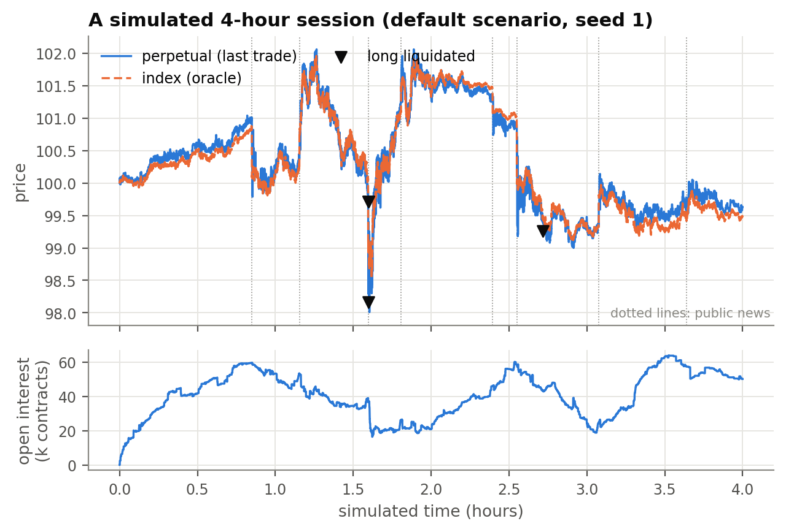

# GLASS

**A transparent perpetual-futures market simulator for multi-agent reinforcement learning.**

[](https://github.com/dudenfa/glass-sim/actions/workflows/tests.yml)
[](LICENSE)
[](pyproject.toml)

GLASS simulates a perpetual-futures exchange from the order book up: agents
trade long and short with leverage, post margin, pay funding and get
liquidated, and prices, liquidity and liquidation cascades emerge from their
interaction rather than from replayed data. Its distinguishing feature is that
**market transparency is an experimental variable**: the same population can
trade on an anonymous exchange, on a venue where every order and trade carries
its owner, or on a fully transparent on-chain book where every account's
position and liquidation price is public, as on Hyperliquid. The package ships
nine scripted trader types, a live browser viewer, Gymnasium and PettingZoo
environments, a multi-agent PPO trainer and an evaluation protocol with paired held-out seeds
and fair controls.



## Features

- **Discrete-event exchange**: price-time priority order book on integer ticks,
  GTC / IOC / post-only / reduce-only orders, self-trade prevention, maker and
  taker fees, per-agent Poisson clocks and random order latency.
- **Perpetual mechanics**: cross-margin accounts, worst-case initial margin,
  liquidation with auto-deleveraging and an insurance fund, a robust mark price,
  hourly funding, an index with stochastic volatility and news jumps.
- **Selectable transparency** (anonymous, attributed, full) enforced at the
  agent's view, plus genuinely private information (early noisy news signals).
- **Reproducible and paired**: one random stream per agent and separate streams
  for the exogenous world, so two treatments with the same seed face exactly
  the same index path and news.
- **Scripted ecology** of nine trader types, including transparency-aware
  strategies (copy trading, wallet watching, liquidation hunting), and eight
  one-change-at-a-time scenarios.
- **Analysis**: market-quality metrics, stylized facts, per-agent path-risk
  statistics, text reports, run and seed-panel comparisons, pandas export.
- **Live viewer**: candles, book with owners, trade tape, positions,
  liquidations, funding and market quality, all in the browser.
- **Reinforcement learning**: Gymnasium environment with action masks and an
  exit-value reward, MaskablePPO training, held-out evaluation against random,
  hold and scripted market-maker controls, an independent-PPO multi-agent
  trainer, a PettingZoo environment for other MARL libraries, and pluggable
  observation, action and reward components.
- **Validated**: an accounting invariant checked every simulated second, 73
  tests, and heavy tails and volatility clustering in the generated prices.
- **Fast**: 4 simulated hours with 88 agents (about 130,000 events) in roughly
  5 seconds on a laptop; the core depends only on NumPy.

## Install

```bash
git clone https://github.com/dudenfa/glass-sim.git
cd glass-sim
python -m venv .venv && source .venv/bin/activate
pip install -e ".[all]"       # simulator + RL (PyTorch via Stable-Baselines3) + analysis + dev tools
```

`pip install -e ".[dev]"` installs the simulator and the test tools only;
`.[analysis]` adds pandas and matplotlib, `.[rl]` adds Gymnasium,
Stable-Baselines3, sb3-contrib and PettingZoo.

## Quick start

```bash
glass scenarios                                   # list the scenarios
glass run --scenario default --seed 1 --agents    # 4 simulated hours, full report
glass serve --open                                # live viewer at http://127.0.0.1:8766
glass compare "scenario=default seed=1" "scenario=default seed=1 transparency=anonymous"
glass compare "scenario=default" "scenario=anonymous" --seeds 1-10   # paired seed panel
```

```python
from glass_sim import PerpetualMarket, scenarios

result = PerpetualMarket(scenarios.default(seed=1)).run()
result.print_report()
summary = result.summary()  # liquidity, price discovery, liquidations, funding, ...
frames = result.to_frames()  # pandas DataFrames: bars, trades, liquidations, equity, ...
```

A custom agent is a class with an `on_wakeup` method. It sees the market
through a view that enforces the transparency level and returns a list of
orders:

```python
from dataclasses import replace
from glass_sim import Agent, AgentSpec, MarketOrder, PerpetualMarket, Side, scenarios


class Contrarian(Agent):
    agent_type = "contrarian"

    def on_wakeup(self, view, rng):
        prices = view.price_history(60)
        if len(prices) < 60:
            return []
        side = Side.SELL if prices[-1] > prices[0] else Side.BUY
        return [MarketOrder(side, 5)]


base = scenarios.default(seed=1)
config = replace(base, agents=base.agents + (AgentSpec(Contrarian, count=5, collateral=20_000.0),))
PerpetualMarket(config).run().print_report()
```

New to GLASS? The [tutorial notebooks](notebooks/) go step by step from a
first market to custom agents, paired experiments and a trained RL agent; they
are saved with their outputs, so you can read them on GitHub. More in
[`examples/`](examples/) and in the [user guide](docs/user-guide.md).

## Transparency levels

| information | ANONYMOUS | ATTRIBUTED | FULL |
|---|:-:|:-:|:-:|
| aggregated book, trade prices and sizes | ✓ | ✓ | ✓ |
| mark, index, funding, open interest | ✓ | ✓ | ✓ |
| owner of every resting order | | ✓ | ✓ |
| buyer and seller of every trade | | ✓ | ✓ |
| every account's position, entry, leverage, PnL, liquidation price | | | ✓ |

Agents always see their own account and orders. Asking for hidden information
raises `TransparencyError`; `view.can_see(level)` lets an agent adapt.

## Scenarios

| scenario | agents | what changes relative to `default` |
|---|---:|---|
| `default` | 88 | reference ecology: nine trader types, FULL transparency, 4 hours |
| `anonymous` / `attributed` | 88 | lower transparency, same population |
| `calm` | 88 | half the index volatility, a quarter of the news |
| `volatile` | 88 | double the volatility and news, larger jumps |
| `retail_frenzy` | 148 | twice the retail traders, all at 20-40x leverage |
| `no_arbitrage` | 84 | without the basis arbitrageurs that anchor the perp to the index |
| `small` | 21 | 30 minutes, for tests and quick checks |

Any field can be overridden, for example `scenarios.default(seed=4, transparency=Transparency.ANONYMOUS)`.

## Reinforcement learning

```bash
glass train --name my_agent --timesteps 1000000 --train-seeds 1000-1999 --episode-duration 4h
glass evaluate checkpoints/my_agent --seeds 31-40          # model vs scripted market maker, random, hold, no agent
glass serve --rl checkpoints/my_agent                      # watch the trained agent trade

python -m glass_sim.rl.marl --name my_marl --learners 3 --timesteps 600000            # several learners together (IPPO)
python -m glass_sim.rl.marl_evaluate checkpoints/my_marl --single checkpoints/my_agent --seeds 31-40
```

The learner observes 32 scaled features (market state, own account and a
transparency block that is zero when hidden), chooses among 9 masked actions,
and is rewarded by the change of its account's *exit value*: what the account
would be worth if the position were closed against the real book, so costs and
illiquidity are visible immediately. A richer "ladder" action menu
(`--actions ladder`) and your own observation, actions or reward can be
plugged in without editing the library.

To use another MARL library, `glass_sim.rl.pettingzoo_env.GlassAECEnv` exposes
several learners in one market through the PettingZoo AEC API (see
[`examples/05_pettingzoo.py`](examples/05_pettingzoo.py)). Details in the
[user guide](docs/user-guide.md#driving-agents-from-outside-rl).

## Project structure

```text
src/glass_sim/        the package
  market.py           discrete-event engine: matching, margin, liquidation, ADL, funding
  book.py, account.py order book and cross-margin accounts
  config.py           ContractSpec, IndexConfig, NewsConfig, ..., MarketConfig
  processes.py        index price, news, private signals
  views.py            MarketView: what an agent can see at each transparency level
  agents/             Agent base class, ExternalAgent, nine scripted traders
  scenarios.py        ready-made populations
  results.py, analysis.py, report.py, compare.py   metrics, stylized facts, reports, comparisons
  rl/                 observation, actions, reward, Gymnasium and PettingZoo envs, training, evaluation, MARL
  live/               browser viewer (session, HTTP server, static web app)
  __main__.py         the `glass` command line
tests/                test suite (pytest)
examples/             runnable examples
notebooks/            step-by-step tutorials
docs/                 user guide and metrics reference
legacy/               the earlier spot-market thesis code (V1), unmaintained
```

## Documentation

- [Tutorials](notebooks/): three notebooks, from a first market to training an RL agent.
- [User guide](docs/user-guide.md): concepts, writing agents, configuration, results, viewer, RL.
- [Metrics reference](docs/metrics.md): every field of the reports and JSON outputs.
- [Documentation index](docs/README.md).

## Citing

If you use GLASS in your research, please cite it (see [`CITATION.cff`](CITATION.cff)):

```bibtex
@software{mantovani2026glass,
  author  = {Mantovani, Martino},
  title   = {GLASS: A Transparent Perpetual-Futures Market Simulator for Multi-Agent Reinforcement Learning},
  year    = {2026},
  version = {0.1.0},
  url     = {https://github.com/dudenfa/glass-sim}
}
```

## Contributing and license

Contributions are welcome; see [`CONTRIBUTING.md`](CONTRIBUTING.md). Released
under the [MIT License](LICENSE).

The earlier spot-market code that preceded GLASS (the V1 thesis experiments)
is kept, unmaintained, in [`legacy/`](legacy/).
